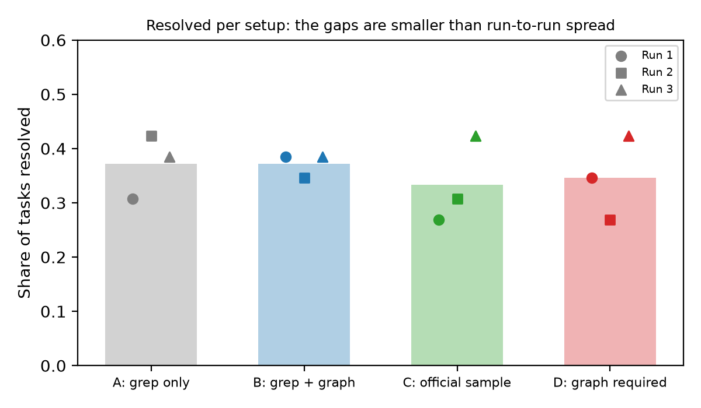
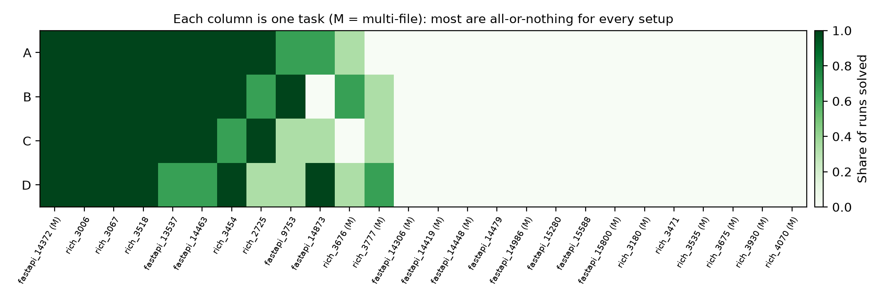
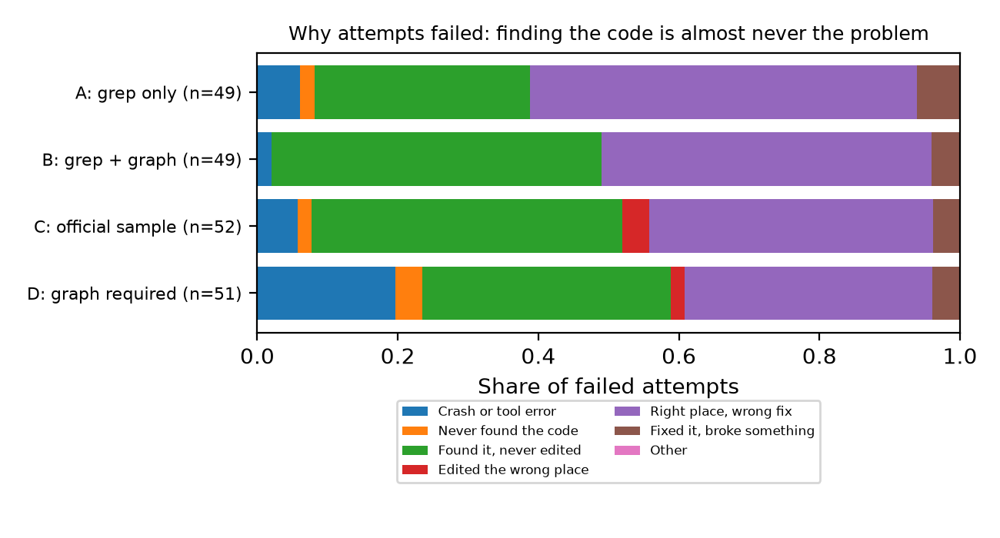
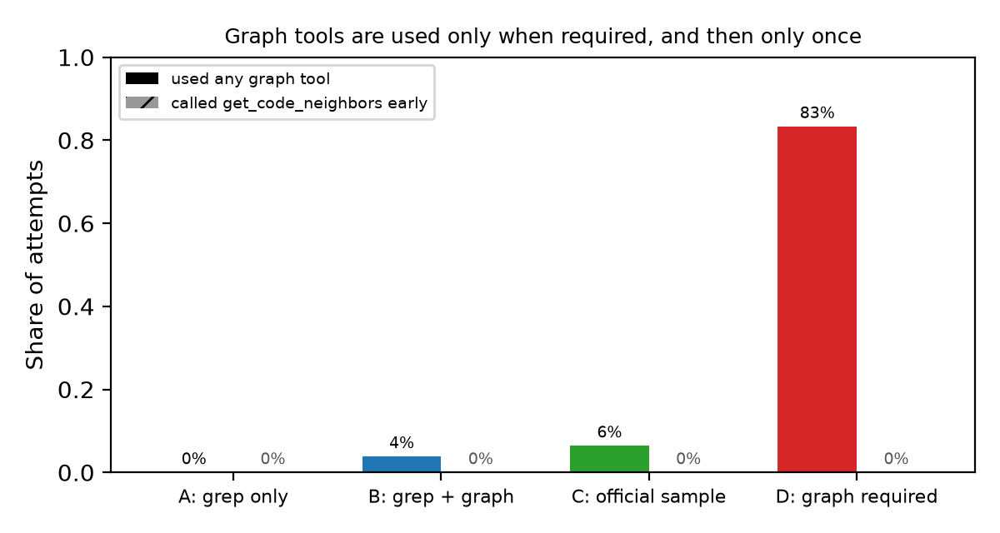

# Given a Map, the Agent Doesn't Look

### Code-graph tools and a small local coding agent: a pre-registered ablation with Gemma 4 31B

**Sumit Mehta**

## Abstract

Code graphs are a popular way to help coding agents navigate repositories, and the Gemma 4 Developer Agent harness ships three graph tools with its sample agent. We ask whether those tools help a small, locally served model (Gemma 4 31B, 4-bit) fix real GitHub issues, and why or why not. We compare four setups that differ only in graph access and prompting: no graph tools, tools available, tools recommended (the official sample), and tools required. Each setup runs on the same 26 tasks, all checked to be solvable in the sandbox, three times: 312 attempts in total. Hypotheses and decision rules were written down before any run. No setup beats grep-only search: resolution rates are 37%, 37%, 33% and 35%, and every gap is smaller than the variation of a single setup between runs. Traces explain why. Unless forced, the agent almost never calls the graph tools (at most 6% of attempts). When forced, it searches once and never follows the graph. Finding the code is rarely the problem: only 4 of 201 failures never opened the file that needed changing. Instead, the agent runs out of time before editing, or edits the right place incorrectly. Which task it is explains 77% of the variation in outcomes; which setup, 0.1%. Graph search results are also 10× larger than other tool output, and requiring them tripled context-overflow crashes. For small agents under tight budgets, better retrieval does not help until the agent can act on what it retrieves.

## 1. Introduction

Coding agents fix bugs by searching a repository, reading code, editing it and running tests. A code graph links functions and classes through calls and definitions, so an agent can jump from a symbol named in an issue to its callers and callees instead of grepping text. Several systems report gains from giving agents graph-based navigation (Section 2). Most of those results use large hosted models with generous budgets.

The Gemma 4 Developer Agent competition asks a different question in practice. Its harness runs a 31B open model, quantized to 4 bits, on four L4 GPUs, with a few minutes per issue. It provides a code graph and embeddings for every task, and three tools over them: `search_similar_code` (embedding search over functions and classes), `get_code_neighbors` (callers, callees and definitions of a symbol) and `get_code_subgraph` (the graph induced by a set of symbols). The official sample agent includes all three and tells the model to prefer them over `grep`.

We test whether these tools help this agent, and if not, why not. Our contributions:

1. **A controlled ablation** with four setups that differ only in graph access and prompting, on 26 solvable tasks, with 3 runs each (312 attempts).
2. **A pre-registered analysis.** Hypotheses, failure categories and the rule for a "real" difference were locked before the first run. Two exploratory setups added later are labelled as such.
3. **A trace-level explanation** of the null result. Tool use, failure categories, per-task consistency and context cost together show where the agent actually fails.
4. **A released analyzer** that turns harness traces into per-attempt rows (failure category, time, tool use, query type), usable on any agent built for this harness.

## 2. Related work

**Benchmarks and agents.** SWE-bench (Jimenez et al., 2024) turned real GitHub issues into pass/fail tests, and is the format this competition's harness follows. SWE-agent (Yang et al., 2024) showed that the design of an agent's tools (its agent-computer interface) changes success rates as much as the model does. We extend that question to graph tools for a small model.

**Graph-augmented navigation.** RepoGraph (Ouyang et al., 2024) adds a repository-level code graph to existing agent and procedural frameworks and reports gains on SWE-bench. CodexGraph (Liu et al., 2024) lets an agent query a graph database of code structure. LocAgent (Chen et al., 2025) uses graph-guided search for localization, the step of finding which code to change. These works mostly use large models. We measure whether a small model uses such tools at all, and which step fails when it doesn't.

**Structure without an agent loop.** AutoCodeRover (Zhang et al., 2024) searches with program-structure APIs (classes, methods). Agentless (Xia et al., 2024) shows that a fixed localize-then-repair pipeline can rival agents. Both suggest that localization is solvable with simple structure. Our failure analysis agrees: localization is not where our agent fails.

**Long context.** Models use information in long inputs unevenly (Liu et al., 2023). Our agent has a 32k-token window, half of it reserved for output, so the size of tool results is a real cost (Section 4.5).

## 3. Experimental setup

### 3.1 Harness, model and budget

We use the competition's harness (`swegemma` 0.2.11), unchanged, with its `subprocess` sandbox, on Kaggle's 4× L4 machines. The model is `gemma-4-31b-it-qat-w4a16-ct`, served by vLLM with the sample's LoRA adapters, temperature 0.2. Every setup has the same budget: 4 minutes and 100 tool calls per attempt, and a 32,768-token context of which 16,384 are reserved for output. All setups share the base tools `run_command` (shell, including `grep`), `read_file`, `edit_file`, `write_file`, `get_status` and `submit_patch`, plus a `code_analyzer` sub-agent.

### 3.2 Tasks

The competition provides 129 tasks from FastAPI, Rich, Requests and HTTPX. Before any run, we excluded tasks whose issue text is empty or names no code and has fewer than 10 words, and tasks whose reference fix changes no library file. Running each task's tests with no patch and with the reference fix showed that **54 of the 104 remaining tasks cannot pass in the sandbox even with the reference fix**, mostly because of missing test dependencies. Requests and HTTPX had no solvable tasks. We kept only solvable tasks and picked 13 multi-file and 13 single-file fixes (FastAPI 13, Rich 13), stratified by repository, with a fixed seed. A fix is multi-file if the reference patch changes two or more library files. The same 26 tasks are used for every setup and run.

### 3.3 Setups

| Setup | Graph tools | Prompt | Status |
|---|---|---|---|
| **A: grep only** | none (graph and embedding files also removed) | sample prompt, graph mentions removed | pre-registered |
| **B: grep + graph** | all 3 | sample prompt minus the one line that recommends `search_similar_code` | pre-registered |
| **C: official sample** | all 3 | the official sample, unchanged | exploratory, added after run 1 |
| **D: graph required** | all 3 | C, but the first call must be `search_similar_code` and the second `get_code_neighbors` | exploratory, added after runs 1–3 |

B removes one prompt line so that A and B differ only in tools. When B made zero graph calls in run 1, we added C (the unchanged sample) to test the tools as shipped. When C also made almost none, we added D to test the tools when actually used. Both were recorded, with their decision rules, before their own results were seen.

### 3.4 Runs and rules

Each setup ran all 26 tasks three times, one task at a time, with setups alternating in each run. That is 312 attempts, all on Kaggle's free 4× L4 quota. The locked rule: **a difference between setups counts as real only if it points the same way in all three runs and is larger than the run-to-run spread of the setups compared.** Pre-registered hypotheses:

- **H1:** graph tools help more on multi-file fixes than on single-file fixes.
- **H2:** graph tools hurt on single-file fixes, through over-exploration.
- **H3a:** failures fall into a few repeating types.
- **H3b:** graph tools shift failures away from "couldn't find the code".
- **H4:** the agent misuses `search_similar_code` with sentence-like queries.

### 3.5 Failure categories

A script assigns each failed attempt the first matching category, using the trace, the agent's patch and the test output:

1. **Crash or tool error:** harness error, context overflow, or at least half the tool calls failed.
2. **Never found the code:** never opened a file the reference fix changes.
3. **Found it, never edited:** opened such a file, but changed no existing file.
4. **Edited the wrong place:** edited files, none of them in the reference fix.
5. **Right place, wrong fix:** edited a reference file, but the issue's tests still fail.
6. **Fixed it, broke something:** the issue's tests pass, but others fail.

A separate flag records whether the attempt hit the time or call limit.

## 4. Results

### 4.1 No setup beats grep

**Table 1. Tasks resolved (of 26) per run.**

| Setup | Run 1 | Run 2 | Run 3 | Total | Spread | Multi-file | Single-file |
|---|---|---|---|---|---|---|---|
| A: grep only | 8 | 11 | 10 | 29/78 (37%) | 3 | 4/39 | 25/39 |
| B: grep + graph | 10 | 9 | 10 | 29/78 (37%) | 1 | 6/39 | 23/39 |
| C: official sample | 7 | 8 | 11 | 26/78 (33%) | 4 | 4/39 | 22/39 |
| D: graph required | 9 | 7 | 11 | 27/78 (35%) | 4 | 6/39 | 21/39 |

Compared with A, B's difference per run is +2, −2, 0; C's is −1, −3, +1; D's is +1, −4, +1. None points the same way in all three runs, and none exceeds the spread, so **no difference is real by our rule** (Figure 1). The ranking of setups changes from run to run, which is what noise looks like.

*Figure 1. Share of tasks resolved per setup. Bars: mean; markers: individual runs.*

**Hypotheses.** H1 is not supported for the pre-registered comparison (B vs. A). For C and D, the multi-file gain does exceed the single-file gain in all three runs, but only because they lose slightly on single-file tasks (C: −1, −2, 0; D: 0, −3, −1), not because they gain on multi-file ones. That is also the direction H2 predicts. Graph setups use more calls on single-file tasks (16.5 for A vs. 18.6–19.1), but the loss is not present in every run, so H2 is not supported either. H3b is not supported as stated (Section 4.3), and H4 could not be tested: B issued no `search_similar_code` calls at all, below our pre-set minimum of 20.

### 4.2 The task decides the outcome

Over 12 attempts per task (4 setups × 3 runs), 14 of 26 tasks were never solved, 4 were always solved, and only 8 were mixed (Figure 2). In a variance decomposition of the 0/1 outcomes, **which task it is explains 77% of the variation; which setup, 0.1%**. Multi-file tasks are much harder for every setup: 20 of 156 attempts resolved, against 91 of 156 single-file attempts.

*Figure 2. Share of runs solved, per task (columns) and setup (rows). (M) marks multi-file tasks.*

### 4.3 Failures happen after the code is found

All 201 failures fit the six categories (0 "other"), supporting H3a. **Only 4 failures (2%) never opened a file that the fix changes**, and 3 more edited only the wrong files. The two dominant categories are "right place, wrong fix" (89) and "found it, never edited" (79). Every "found it, never edited" attempt hit the 4-minute limit. The agent had the right file open and ran out of time before changing it (Figure 3).

*Figure 3. Failure categories as a share of each setup's failures.*

H3b predicted that graph tools would shrink the "couldn't find the code" share. That share is near zero in every setup, so there is nothing to shrink. One pattern did hold in all three runs: B had more "found it, never edited" failures than A (7, 8, 8 vs. 6, 4, 5), and so did C. Both B and C hit the time limit more often (38 and 40 times vs. A's 32), despite making almost no graph calls. One possible cause is the longer tool list and tool descriptions in their prompts, but the counts are small and we report this as a pattern, not a finding.

### 4.4 The tools are used only when required, and then only once

| Setup | Attempts using any graph tool | First call is `search_similar_code` | `get_code_neighbors` in first 2 calls |
|---|---|---|---|
| A | 0 / 78 | 0 | 0 |
| B | 3 / 78 | 0 | 0 |
| C | 5 / 78 | 0 | 0 |
| D | 65 / 78 | 59 | 0 |

In B and C the tools appear in the tool schemas, in a harness section describing them and in the sub-agent's prompt; C's prompt also recommends `search_similar_code`. Even so, the agent used a graph tool in at most 6% of attempts. In none of the 234 attempts of A, B and C was a graph tool the first call. Only an explicit instruction (D) changed this, with 76% compliance on the first call. Even then, **no attempt followed the instruction to call `get_code_neighbors` next**. The agent used the graph as a one-shot search box, then went back to reading files (Figure 4). The queries themselves were well formed: 78 of D's 79 searches used code identifiers, not sentences, and 72 returned results.

*Figure 4. Share of attempts that used any graph tool, and that called `get_code_neighbors` early.*

### 4.5 Graph results cost context

D crashed in 10 of 78 attempts, against 3, 1 and 3 for A, B and C. Nine of D's crashes were context overflows: the conversation grew past the model's window. A single `search_similar_code` result is about 6,000 characters (median over 79 calls), **ten times the median result of other tools** (about 600). The input budget is about 16k tokens, so each search uses roughly a tenth of it. Eight of the ten crashed attempts had called the graph tool, and most of the crashed tasks never crashed under A or B. The counts are small, but the cost is concrete.

### 4.6 Graph coverage is not the problem

Graph blind spots (such as missed `self.` calls) don't explain our result. The reference fixes change 49 functions or classes that have graph nodes, and only 4 of those nodes have no edges. In 6 tasks, the changed lines could not be matched to any node, for example because the fix adds new code.

## 5. Discussion

**Why doesn't the agent use the tools?** The model has a strong default workflow: grep, read, edit, test. Issues here usually name a function, class or error message, so `grep` and `read_file` find the right file almost every time. The graph tools solve a problem the agent rarely has. A tool that duplicates a reliable habit is skipped; a prompt recommendation doesn't change that, and a requirement changes only the first call.

**Where does the agent actually fail?** In the 4 minutes after finding the code. Failures split between running out of time before editing and editing the right place incorrectly. Neither is a navigation problem. Help for this agent would target the repair step: tighter reasoning about the fix, cheaper test runs, or more time. Better retrieval would not.

**What does this mean for graph tools?** Code graphs are not useless: larger models with longer budgets report gains, and our multi-file tasks, where structure should matter most, were nearly unsolved by every setup. Our results point to three practical conditions for graph tools to help a small agent:

- results compact enough for a 16k-token input budget;
- tasks where text search actually fails;
- an agent able to turn a better location into a correct edit within its budget.

**Method lesson.** A single run would have produced a "finding" in either direction: B beat A in run 1, A beat B in run 2. We suggest tool-ablation studies repeat runs, compare within tasks, and report whether the agent used the tool at all.

## 6. Limitations

- **Scope:** two Python repositories, one model and quantization, and a tight 4-minute budget. Results may differ for larger models or longer budgets.
- **Sample size:** 26 tasks, of which 14 were never solved by any setup, so only about 12 tasks can show a difference. Small effects would not be detected.
- **Exploratory setups:** C and D were added after seeing earlier results. They ran in later sessions (D a week later) on the same harness, model, tasks, budget and machine type.
- **Benchmark validity:** over half of the eligible tasks cannot pass in the official sandbox even with the reference fix. We report this and use only checked tasks.
- **Labels:** failure categories are assigned by script and not yet hand-checked.

## 7. Reproducibility

Code: https://github.com/sumitmehta1025/given-a-map (Apache 2.0). It holds the run script and Kaggle notebook, the 4 setups as diffs against the official sample, task selection (seed 20261016), the solvability check, the trace analyzer, the script behind every table and figure, the per-attempt table, and the locked plan with its change log. Raw traces are withheld: they contain competition data. Claude (Anthropic) assisted with analysis code and drafting.

## References

- Chen, Z. et al. (2025). LocAgent: Graph-guided LLM agents for code localization. arXiv:2503.09089.
- Jimenez, C. E. et al. (2024). SWE-bench: Can language models resolve real-world GitHub issues? ICLR 2024. arXiv:2310.06770.
- Liu, N. F. et al. (2023). Lost in the middle: How language models use long contexts. arXiv:2307.03172.
- Liu, X. et al. (2024). CodexGraph: Bridging large language models and code repositories via code graph databases. arXiv:2408.03910.
- Ouyang, S. et al. (2024). RepoGraph: Enhancing AI software engineering with repository-level code graph. ICLR 2025. arXiv:2410.14684.
- Xia, C. S. et al. (2024). Agentless: Demystifying LLM-based software engineering agents. arXiv:2407.01489.
- Yang, J. et al. (2024). SWE-agent: Agent-computer interfaces enable automated software engineering. arXiv:2405.15793.
- Zhang, Y. et al. (2024). AutoCodeRover: Autonomous program improvement. ISSTA 2024. arXiv:2404.05427.
